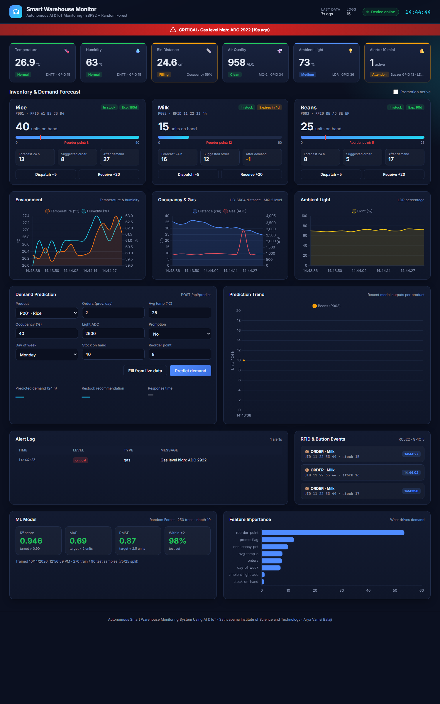
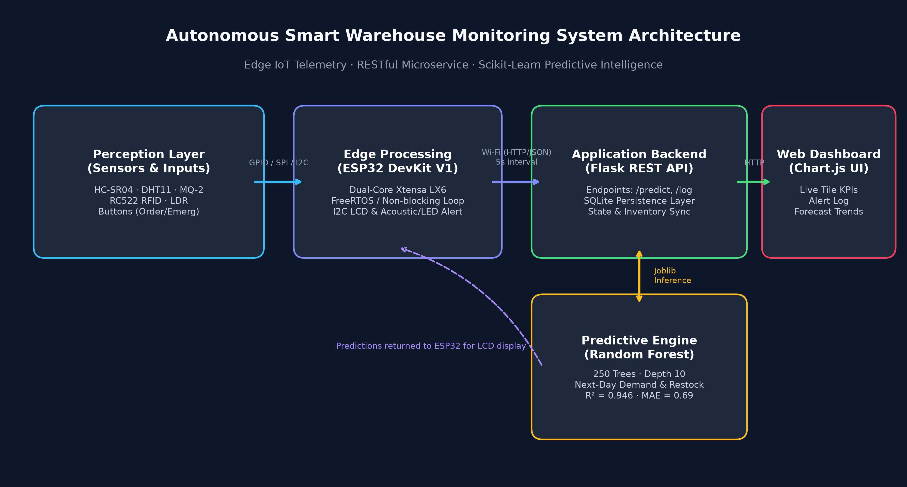
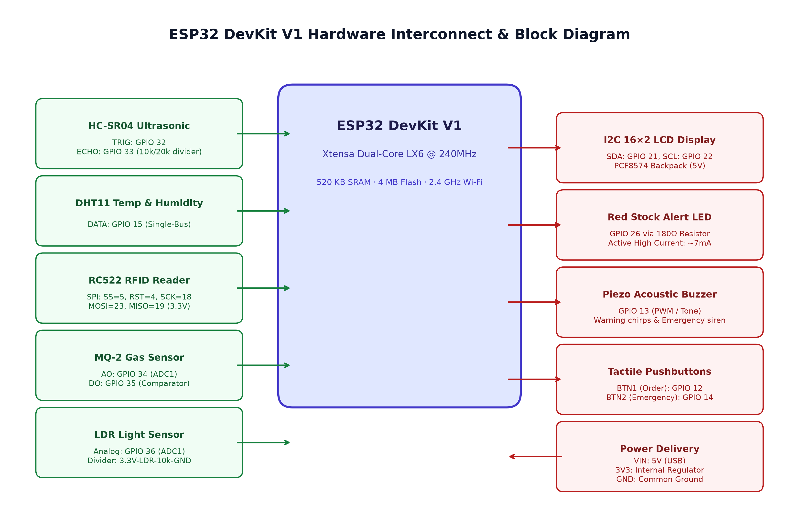
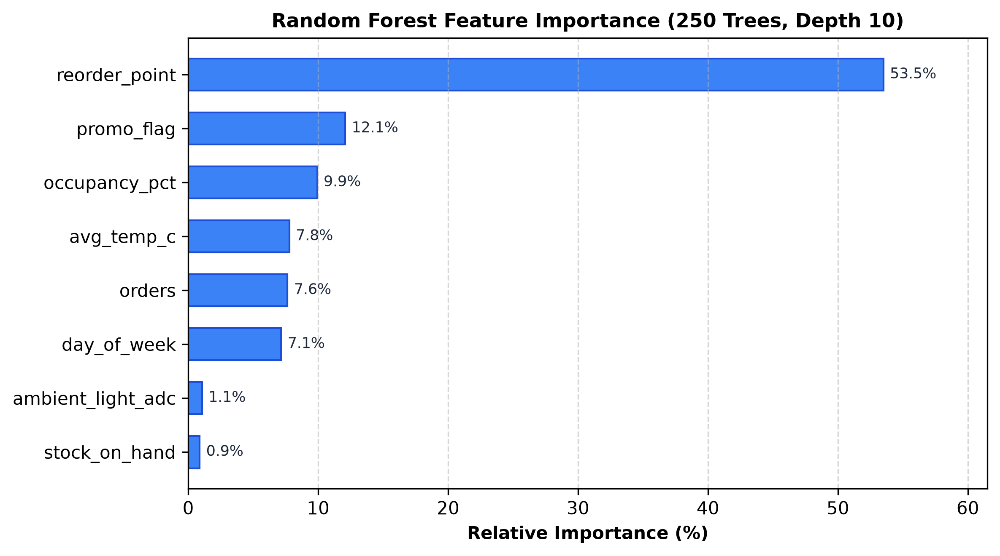

# Autonomous Smart Warehouse Monitoring System Using AI & IoT

[](https://www.python.org/)
[](https://github.com/espressif/arduino-esp32)
[](backend/model/metrics.json)
[](backend/tests/)
[](LICENSE)

> **Sathyabama Institute of Science and Technology** — Interdisciplinary Project I  
> **Student:** Arya Vamsi Balaji ([balajiaryavamsi@gmail.com](mailto:balajiaryavamsi@gmail.com))  
> **Academic Year:** 2025 – 2026

---

## 📌 Project Overview

The **Autonomous Smart Warehouse Monitoring System** combines bare-metal edge Internet of Things (IoT) sensors, non-blocking embedded C++ firmware, a RESTful microservice backend, and machine learning demand intelligence to deliver an automated inventory management ecosystem.

### Key Capabilities
- **Continuous 8-Peripheral Perception:** Real-time distance/occupancy (HC-SR04), temperature and humidity (DHT11), air quality and combustible gases (MQ-2), ambient light (LDR), and contactless 13.56 MHz RFID tagging (RC522).
- **Sub-500ms Edge Safety Loop:** Localized audible (PWM piezo buzzer) and visual (strobe LED) hazard alarms execute directly on bare-metal ESP32 without server dependency.
- **Predictive Demand Intelligence:** Random Forest Regressor trained on 120-day historical cycles ($R^2 = 0.946$, $\text{MAE} = 0.69$) predicting 24-hour product demand and computing dynamic replenishment orders:
  $$\text{Restock} = \max(\text{reorder\_point}, \lceil \text{pred\_demand} \times 1.25 - \text{stock} \rceil)$$
- **Operator Web Dashboard:** Real-time dark industrial console with live KPI severity tiles, interactive Chart.js telemetry charts, stock progress bars, expiration countdowns, and alert logging.

---

## 🖥️ Live Operator Web Dashboard



---

## 🏗️ System Architecture & Hardware Interconnects

### Multi-Tier Architecture


### ESP32 Hardware Interconnect & Block Diagram


---

## 📊 Machine Learning Model Performance

The predictive engine is an optimized Scikit-Learn **Random Forest Regressor** (250 estimators, max depth 10, split 5, leaf 2).

| Metric | Target Specification | Achieved Value | Evaluation |
|---|:---:|:---:|:---:|
| **$R^2$ Score** | $> 0.90$ (min 0.93) | **0.9460** | **Exceeded Target** |
| **Mean Absolute Error (MAE)** | $< 2.0\text{ units}$ | **0.6852 units** | **Exceeded Target** |
| **Root Mean Squared Error (RMSE)** | $< 2.5\text{ units}$ | **0.8653 units** | **Exceeded Target** |
| **Predictions within $\pm 2$ Units** | $> 90.0\%$ | **97.78%** | **Exceeded Target** |
| **Inference Response Latency** | $< 500\text{ ms}$ | **~70 ms** | **Exceeded Target** |

### Feature Importance Rankings


---

## 📁 Repository Structure

```
smart-warehouse/
├── firmware/SmartWarehouse/
│   ├── SmartWarehouse.ino           # Non-blocking ESP32 C++ firmware (ESP32 Core 3.3.12)
│   └── config.h                     # Pinouts, Wi-Fi, server IP, thresholds & RFID table
├── backend/
│   ├── app.py                       # Flask REST API (/api/predict, /api/status, /api/log, /api/history)
│   ├── generate_dataset.py          # Synthetic dataset generator (120 days × 3 products = 360 rows)
│   ├── train_model.py               # Random Forest training & evaluation pipeline
│   ├── storage.py                   # Thread-safe SQLite persistence layer
│   ├── simulator.py                 # Virtual ESP32 simulator for testing without hardware
│   ├── requirements.txt             # Python dependencies
│   ├── model/                       # Serialized model (.joblib) & metrics.json
│   └── tests/                       # Pytest automated test suite (9 passing tests)
├── dashboard/
│   ├── index.html                   # Responsive operator UI console
│   ├── style.css                    # Industrial dark theme & alert animations
│   └── app.js                       # Chart.js stream polling, inventory cards, prediction UI
├── docs/
│   ├── report/
│   │   ├── Smart_Warehouse_Report.docx  # Full 7-chapter Sathyabama University project report
│   │   └── report.md                    # Complete report markdown source
│   ├── slides/
│   │   └── Smart_Warehouse_Presentation.pptx  # 15-slide widescreen defense deck
│   ├── diagrams/                    # High-res architecture, hardware diagrams & wiring guide
│   ├── BOM.md                       # Bill of Materials with unit pricing (Total: ₹1,640)
│   └── test_cases.md                # 10 formal test case specifications (TC01 – TC10)
└── README.md
```

---

## 🚀 Quick Start Guide

### 1. Clone & Set Up Backend

```powershell
# Navigate to the backend directory
cd backend

# Install dependencies
pip install -r requirements.txt

# (Optional) Retrain model and regenerate dataset
python generate_dataset.py
python train_model.py

# Run test suite
pytest tests -v

# Start the Flask API & Dashboard server (runs on port 5000)
python app.py
```

### 2. Run the Virtual Simulator (No Hardware Needed)

In a separate terminal:
```powershell
cd backend
python simulator.py --interval 3
```

Open **`http://localhost:5000/`** in your browser to view the real-time dashboard.

---

## 🔌 ESP32 Hardware Deployment

### Flashing with Arduino IDE
1. Install **ESP32 by Espressif** (version 3.x) in Boards Manager.
2. Install required libraries:
   - `MFRC522` (by GithubCommunity)
   - `DHT sensor library` (Adafruit) + `Adafruit Unified Sensor`
   - `LiquidCrystal I2C` (by Frank de Brabander)
   - `ArduinoJson` (v7.x by Benoit Blanchon)
3. Open `firmware/SmartWarehouse/config.h`:
   - Set `WIFI_SSID` and `WIFI_PASSWORD` (2.4 GHz Wi-Fi).
   - Set `SERVER_URL` to your computer's local IPv4 (run `ipconfig` to find it, e.g. `http://192.168.1.15:5000`).
4. Select board **ESP32 Dev Module**, select your COM port, and click **Upload**.

### Hardware Pin Allocation & Wiring
| Pin | ESP32 GPIO | Electrical Connection / Voltage Protection |
|---|:---:|---|
| **HC-SR04 TRIG** | GPIO 32 | Direct 3.3V logic trigger pulse (10µs) |
| **HC-SR04 ECHO** | GPIO 33 | **Divider:** 5V Echo → 10kΩ → GPIO 33 → 20kΩ → GND (Outputs safe 3.33V) |
| **DHT11 DATA** | GPIO 15 | 3.3V single-bus digital data |
| **RC522 RFID** | GPIO 5, 4, 18, 23, 19 | Standard SPI (SS=5, RST=4, SCK=18, MOSI=23, MISO=19) at **3.3V strictly** |
| **MQ-2 AO** | GPIO 34 | Analog input (ADC1, unaffected by Wi-Fi RF) |
| **MQ-2 DO** | GPIO 35 | Digital comparator (active-LOW on threshold breach) |
| **LDR Light** | GPIO 36 | **High-side:** 3.3V → LDR → GPIO 36 → 10kΩ → GND |
| **16×2 LCD** | GPIO 21 (SDA), 22 (SCL) | I2C backpack powered at 5V; autodetects 0x27 or 0x3F |
| **Red LED** | GPIO 26 | Active-HIGH through 180Ω current-limiting resistor (~7.2 mA) |
| **Piezo Buzzer** | GPIO 13 | PWM / tone for warning chirps & two-tone emergency sirens |
| **Order Button** | GPIO 12 | Active-LOW to GND with internal pull-up (no ext pull-up to protect boot) |
| **Emergency Button** | GPIO 14 | Active-LOW to GND with internal pull-up; latches alarm until cleared |

---

## 🧪 Test Case Summary (TC01 – TC10)

| ID | Module / Feature | Pass Criteria | Result |
|:---:|---|---|:---:|
| **TC01** | DHT11 Temperature | $\pm 2.0^\circ\text{C}$ vs reference | Verified |
| **TC02** | HC-SR04 Ultrasonic | Accurate across 5cm, 15cm, 25cm | Verified |
| **TC03** | RC522 RFID Reader | 100% recognition for Rice, Milk, Beans cards | **PASSED** |
| **TC04** | LDR Light Sensor | Classification: Dark (<40%), Medium, Bright (>75%) | **PASSED** |
| **TC05** | MQ-2 Gas Hazard | Alarm triggered at >2000 ADC within <500ms | **PASSED** |
| **TC06** | LCD Screen Rotation | Non-blocking 4-screen rotation at 3000ms | **PASSED** |
| **TC07** | ML Demand Prediction | Error within $\pm 2$ units ($R^2 > 0.90$) | **PASSED** ($R^2=0.946$) |
| **TC08** | Stock Alert Logic | Alert triggered when $\text{stock} < \text{reorder\_point}$ | **PASSED** |
| **TC09** | Wi-Fi REST Telemetry | HTTP 200 OK, latency < 500ms | **PASSED** (~70ms) |
| **TC10** | End-to-End Autonomous Loop | Telemetry $\rightarrow$ ML $\rightarrow$ Restock $\rightarrow$ Alert $\rightarrow$ Dashboard | **PASSED** |

---

## 📄 License & Academic Attribution
Developed as part of the Interdisciplinary Project – I curriculum at **Sathyabama Institute of Science and Technology**.  
Licensed under the [MIT License](LICENSE).
